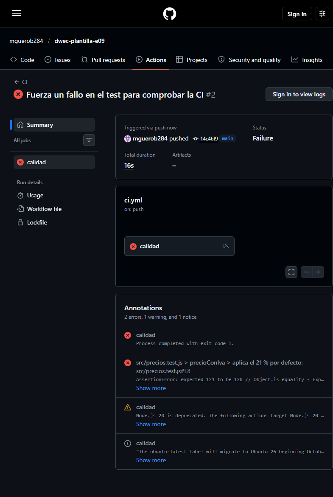
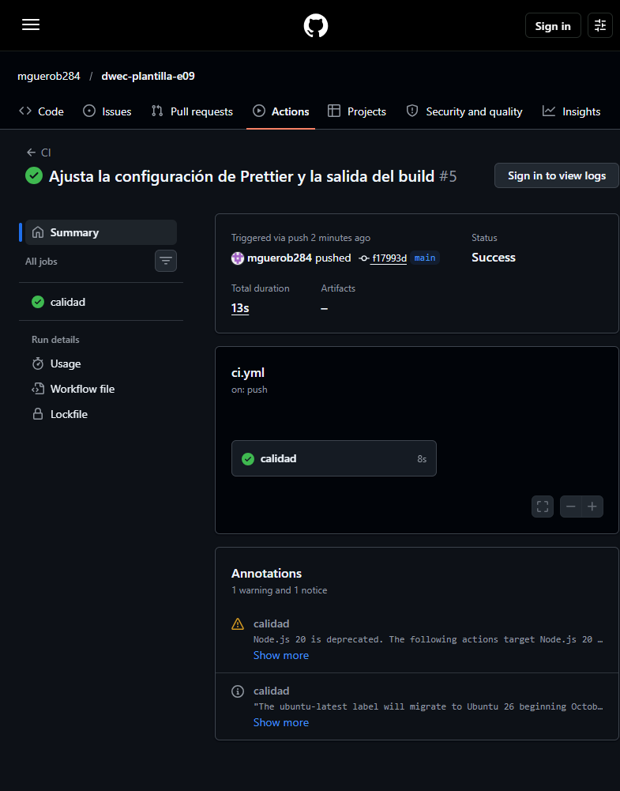

# Plantilla DWEC

Aplicación de ejemplo para la plantilla de proyecto del curso: una calculadora de precios con IVA y descuento. Sirve para practicar un entorno reproducible con Dev Containers, la calidad del código, las pruebas y la integración continua.

## Requisitos

- Node.js 24 y npm (el Dev Container ya los incluye).
- Docker y la extensión **Dev Containers** de VS Code, o Node.js 24 instalado en el equipo.
- No hace falta instalar nada de forma global.

## Instalación y ejecución

1. Abre la carpeta del ejercicio en VS Code y elige **Dev Containers: Reopen in Container**. El contenedor instala las dependencias con `npm install` al crearse.
2. En la terminal del contenedor, arranca el servidor:

   ```bash
   npm run dev
   ```

3. Abre <http://localhost:5173>.

Con precio `100`, IVA del 21 % y descuento `10` la página muestra **Precio final: 108,90 €**. El campo de descuento tiene `max="100"`, así que el navegador bloquea el envío de `150`; si se omite esa validación nativa, la aplicación muestra **❌ El descuento debe estar entre 0 y 100**.

Para instalar exactamente las versiones del `package-lock.json`:

```bash
npm ci
```

## Scripts

| Script | Qué hace |
|--------|----------|
| `npm run dev` | Arranca Vite en el puerto 5173 con recarga en caliente. |
| `npm run build` | Compila la aplicación para producción en `dist/`. |
| `npm run preview` | Sirve localmente el contenido de `dist/` para comprobarlo. |
| `npm test` | Ejecuta Vitest en modo vigilancia. |
| `npm run lint` | Revisa el código con ESLint. |
| `npm run format` | Formatea el proyecto con Prettier. |

## Estructura

```text
.
├── .devcontainer/
│   └── devcontainer.json      Imagen Node 24, extensiones, puerto 5173 y npm install
├── .github/
│   └── workflows/
│       └── ci.yml             Integración continua en GitHub Actions
├── .gitignore                 node_modules/, dist/ y coverage/
├── .prettierignore            Ficheros que Prettier no revisa
├── .prettierrc                Reglas de formato
├── eslint.config.js           Reglas de ESLint
├── index.html                 Formulario y resultado
├── package.json               Dependencias y scripts
├── package-lock.json          Versiones exactas de las dependencias
├── src/
│   ├── main.js                Comportamiento del formulario
│   ├── precios.js             Lógica de precios con IVA y descuento
│   ├── precios.test.js        Once tests con Vitest
│   └── style.css              Estilos
└── img/
    ├── ci-rojo.png            Captura de la ejecución fallida
    └── ci.png                 Captura de la última ejecución correcta
```

`node_modules/` y `dist/` se generan al instalar y compilar; están en `.gitignore` y no se suben al repositorio.

## Arquitectura

1. **Modelo de aplicación.** Es una aplicación de cliente: el HTML, el CSS y el JavaScript se descargan y se ejecutan en el navegador. No hay lógica en un servidor ni acceso a una base de datos. En producción se sube el contenido estático de `dist/` a cualquier servidor web o servicio de hosting estático.
2. **Carga de scripts.** `index.html` carga `/src/main.js` con `<script type="module">`. El navegador lo trata como un módulo ES: se ejecuta en modo estricto, con ámbito propio y después de parsear el documento, y resuelve los `import` de `precios.js` y `style.css`. En desarrollo, Vite sirve cada módulo por separado. Al ejecutar `npm run build`, Vite agrupa y minimiza el JavaScript en `dist/assets/index-*.js`, extrae el CSS a `dist/assets/index-*.css` y reescribe `dist/index.html` para cargar esos ficheros con un hash en el nombre.
3. **Separación de capas.** `index.html` contiene la estructura y el contenido; `src/style.css`, la presentación; `src/main.js`, el comportamiento y la conexión con el DOM; `src/precios.js`, la lógica pura de cálculo; y `src/precios.test.js`, las pruebas de esa lógica. Las herramientas (`eslint.config.js`, `.prettierrc`, `vitest` y Vite) están separadas del código de la aplicación.

## Calidad

`npm run lint` termina sin errores:

```text
> plantilla-dwec@1.0.0 lint
> eslint .
```

`npx prettier --check .` confirma que todo está formateado:

```text
Checking formatting...
All matched files use Prettier code style!
```

`npx vitest run` ejecuta los once tests:

```text
 RUN  v5.0.5 /work

 ✓ src/precios.test.js (11 tests) 4ms

 Test Files  1 passed (1)
      Tests  11 passed (11)
```

`npm run build` genera `dist/`:

```text
> plantilla-dwec@1.0.0 build
> vite build

vite v8.3.5 building client environment for production...
transforming...
✓ 6 modules transformed.
rendering chunks...
computing gzip size...
dist/index.html                 1.21 kB │ gzip: 0.57 kB
dist/assets/index-BxHOtSx5.css  0.30 kB │ gzip: 0.22 kB
dist/assets/index-aDXYxtym.js   1.40 kB │ gzip: 0.75 kB

✓ built in 378ms
```

## Pruebas

1. El test `aplica el 21 % por defecto` llama a `precioConIva(100)` sin indicar el IVA y espera `121`: comprueba que el valor por defecto es el 21 % y que el resultado se redondea a céntimos. El test `lanza un error si el descuento es mayor que 100` llama a `aplicarDescuento(100, 150)` dentro de `expect(...).toThrow('entre 0 y 100')`: comprueba que la función rechaza un porcentaje fuera del rango y que el mensaje del error es el esperado.
2. Si se quitara `redondear()` de `src/precios.js`, fallarían los tests que usan resultados con decimales: `precioConIva(9.99)` daría `12.0879` en vez de `12.09`; `precioConIva(100, 0.1)` daría `110.00000000000001` en vez de `110`; y `aplicarDescuento(19.99, 15)` daría `16.9915` en vez de `16.99`. Los tests que esperan enteros exactos, como `precioConIva(100)` o `aplicarDescuento(80, 25)`, seguirían pasando. El redondeo evita que los errores de coma flotante y los céntimos incompletos lleguen a la interfaz.

## Integración continua

El workflow `.github/workflows/ci.yml` se ejecuta en cada `push` a `main` y, en una máquina Ubuntu con Node.js 24, descarga el código, instala con `npm ci`, pasa ESLint, comprueba el formato con Prettier, ejecuta los tests con `npx vitest run` y compila con `npm run build`.

Para comprobar que la CI detecta un fallo, cambié a propósito el valor esperado del primer test de `121` a `120`. El paso **Tests** falló con un error de aserción: el resultado real era `121` y el test esperaba `120`. El fallo estaba en el valor esperado del test, no en `src/precios.js`. Después volví a poner `121`, hice otro commit y la última ejecución terminó en verde.




